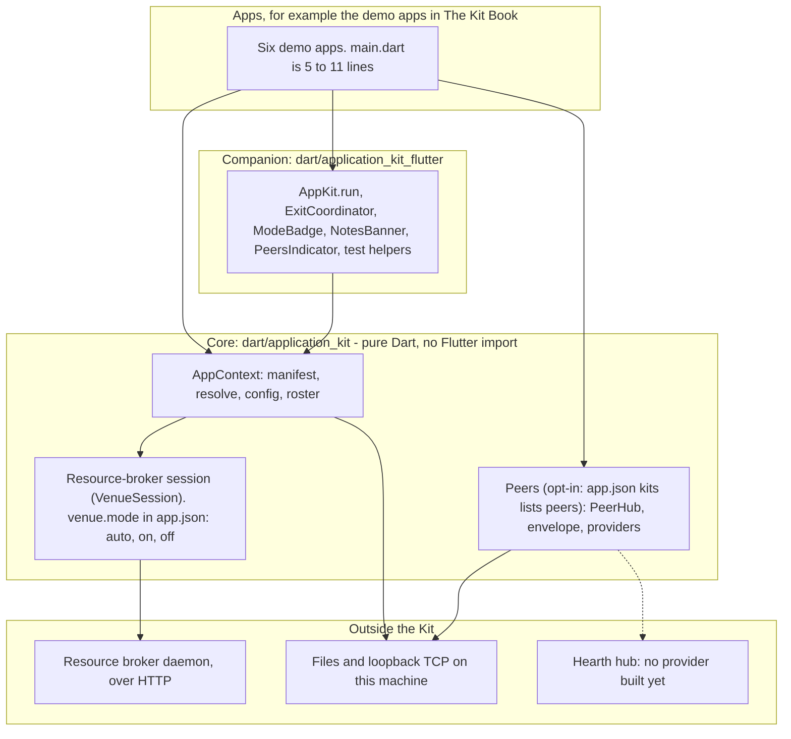
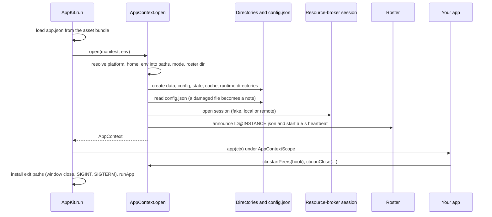
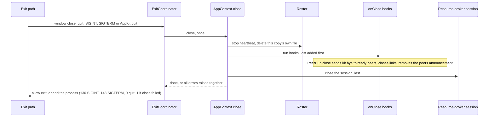
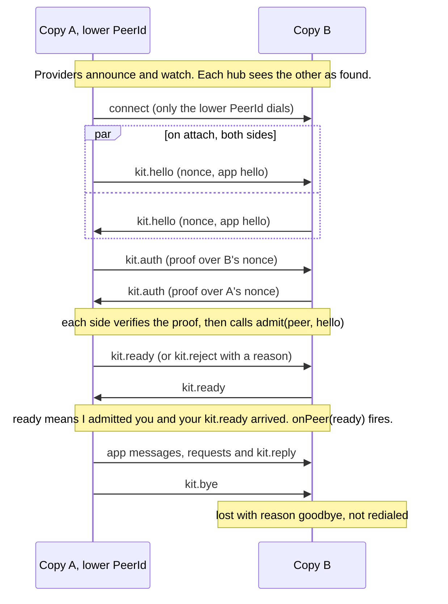
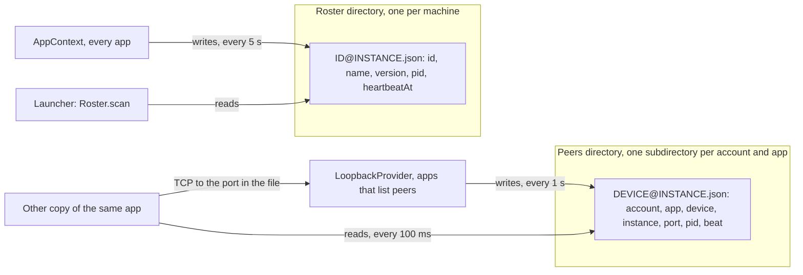
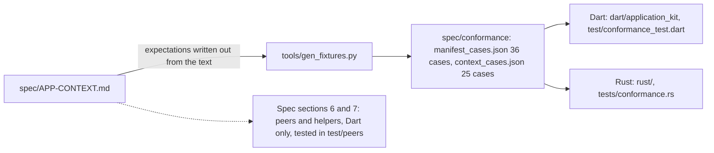

<!-- Generated by tools/pull-docs.py from application-kit at e70ded6 (docs/ARCHITECTURE.md). Do not edit by hand: edit it in the Kit, then run make docs-pull. -->

# Architecture

> Reference page pulled from application-kit at commit e70ded6. Edit it in the Kit, not here.

This page explains how the Application Kit is put together: the layers, what happens when an app starts and stops, how two copies of an app connect, and how the spec, the shared test fixtures and the two implementations fit together. The name "Application Kit" is provisional.

The Kit gives one running app a root object, `AppContext`. An app gets its identity (the reverse-DNS `id` in `app.json`), its directories, its settings, a test mode, a presence entry in a shared roster, a session with a resource broker, and an opt-in way to find and talk to other copies of itself.

Diagrams are Mermaid, which GitHub renders. Every diagram is checked against the code named under it.

Contents: [layers](#1-layers-and-the-direction-of-dependency) · [startup](#2-startup) · [shutdown](#3-shutdown) · [the peer handshake](#4-the-peer-handshake) · [roster and peers announcement](#5-the-roster-and-the-peers-announcement-are-different-things) · [spec, fixtures, implementations](#6-where-the-spec-the-fixtures-and-the-two-implementations-meet) · [why these boundaries](#why-these-boundaries)

## 1. Layers and the direction of dependency

Arrows point from a layer to what it depends on. The dotted arrow is planned, not built.

**What to notice.** The core, `dart/application_kit`, imports no Flutter and depends on one package, `crypto`. The companion depends on the core and adds only what needs Flutter: loading `app.json` from an asset, one guarded exit path, a mode badge, a notes banner, a peers indicator, and widget-test helpers. Nothing in the Kit depends on an app. The Rust crate in `rust/` is a separate implementation of spec sections 1 to 5 and is not part of this stack.

The apps use the core directly for their own logic and hooks, and the companion for startup and widgets.

Peers are opt-in in a literal way: `ctx.startPeers` throws `KitNotDeclared` unless `app.json` lists `"peers"` in `kits`. That is the only place the `kits` list gates anything today. The resource-broker session is controlled by `venue.mode` instead (`off` never connects, `auto` connects if a token exists and the daemon answers, otherwise falls back to a local session and says so, `on` fails to open if it cannot connect), and in mock mode it is always an in-memory fake.

## 2. Startup

Source: `AppKit.run` in `app_kit.dart` and `AppContext.open` in `app_context.dart`.

**What to notice.** The order is chosen so a failure leaves nothing behind. The resource-broker session opens before the roster entry is written, so a session that refuses to open (mode `on`) fails before anything is announced. If announcing fails, the session is closed again. If the manifest cannot be read or the context cannot open, `AppKit.run` shows an error screen with the error code instead of crashing. Your app's builder runs before the exit paths are installed, so any hook it registers with `ctx.onClose` is in place before the window can be closed. If the builder throws, the context is closed again and the error screen shows `app-build-failed`.

## 3. Shutdown

Source: `ExitCoordinator` in `exit_coordinator.dart` and `AppContext._closeOnce` in `app_context.dart`.

**What to notice.** Every exit path funnels into one shutdown that closes the context at most once; a second signal gets the same future instead of a second close. Every step runs even if an earlier one throws, and the errors are raised together afterwards. A failing close is written to stderr and does not block the exit, and there is no timeout, so a hung hook is a bug in the hook. `SIGKILL` skips all of this, which is why the roster and the peers announcement both carry a timestamp that goes stale.

## 4. The peer handshake

Source: the protocol comment at the top of `hub.dart`, checked against `_onHello`, `_onAuth` and `_checkReady`.

**What to notice.** Only the copy with the lower `PeerId` dials, so two copies never open two links; the other side waits for the incoming link. That works only if discovery is symmetric, which it is for both built providers. "Ready" needs two things on each side: your `admit` said yes, and the other side's `kit.ready` arrived. A link that is not ready after 5 seconds is dropped. A `kit.reject` marks the peer rejected on both sides, and it is not redialed until the provider withdraws and announces it again.

## 5. The roster and the peers announcement are different things

Both are small JSON files that a process rewrites on a timer and others treat as dead when the timer stops. They answer different questions.

| | Roster | Peers announcement |
|---|---|---|
| Question | What is running on this machine? | Which copies of my app can I connect to? |
| Written by | `AppContext.open`, for every app | `LoopbackProvider`, for apps that start peers |
| Path | `<roster dir>/<app id>@<instance>.json` | `<peers dir>/<account>/<app id>/<device>@<instance>.json` |
| Contents | `id`, `instance`, `name`, `version`, `pid`, `startedAt`, `heartbeatAt` | `account`, `app`, `device`, `instance`, `port`, `pid`, `beat` |
| Read by | Any viewer, such as the launcher app, through `Roster.scan()` | Each copy's provider, which lists only its own account and app |
| Rewritten every | 5 s | 1 s |
| Treated as stale after | 15 s (a reader's choice: `scan()` reports `live`, `stale` or `unreadable`) | 4 s (not offered); deleted by whoever notices after 60 s |
| Directory | One per machine, shared by all apps | One per account and app, so a hub never reads another scope's files |

**What to notice.** The roster is for people and tools that want to see every app. The peers announcement is for copies of one app that want to connect, so it carries a port and is partitioned by scope. The staleness numbers differ because the cost of being wrong differs: a launcher that shows a crashed app as running for a few seconds is a cosmetic problem, while a hub that keeps a dead copy in its peer list wastes dials and shows a peer that is not there. Other providers have no files at all: the fake network is in memory, and a Hearth provider would use topics.

These are two separate implementations of one idea (write a file, rewrite it on a timer, treat it as dead when the timer stops) with different constants. Folding them into one shared primitive is a possible simplification that has not been done.

## 6. Where the spec, the fixtures and the two implementations meet

The fixtures cover the manifest rules (spec section 1) and path, mode and roster resolution (section 2). They are pure functions: no files, no network, which is what lets two languages check the same cases. `tools/gen_fixtures.py` writes the expectations out by hand from the spec text; no implementation computes them. Run the conformance checks with `cd dart/application_kit && dart test test/conformance_test.dart` and `cd rust && cargo test --no-default-features --test conformance`.

**What to notice.** The rule is that the fixture wins: if the prose and a fixture disagree, the prose is fixed. Behaviour that touches the outside world (config files, the roster, the resource-broker session, token lookup) is in the spec but not in the fixtures, so each language tests it itself. The Rust crate covers spec sections 1 to 5. The peer layer (section 6) and the later helpers (section 7) exist in Dart only, and are covered by Dart tests, including real processes in `test/peers/two_process_test.dart`.

## Why these boundaries

**The Kit does not interpret payloads.** The same hub carries three very different meanings in the demo apps: a signal (stopwatch), replicated notes with a conflict rule (notepad), and handing a game to another copy (minesweeper). Adding coordination to those three apps changed no file under `dart/application_kit`. If the Kit knew what a message meant, the first app whose meaning was different would have needed a Kit change. Keeping it opaque also means the Kit has nothing to get wrong about your data, and nothing in your data can confuse it: the Kit parses its own header and passes the payload on untouched.

**The core avoids Flutter.** Closing an app cleanly on window close or quit needs Flutter's lifecycle, and starting needs its asset bundle, so those live in the companion package. Everything else runs under plain `dart test` with no engine. The core test suite (360 passed, 7 skipped) runs in about half a minute, and the peers logic runs as a headless process; the three demo apps that use peers each have a `tool/peer_probe.dart` that runs the app's own coordination code without a window. The same boundary is what makes a second implementation possible: the Rust crate follows the same spec without touching Flutter.

**One spec, with shared fixtures.** A written spec alone lets two implementations drift. The fixtures turn the pure parts of it into data that both languages must pass, and the rule that the fixture wins keeps the prose honest. The fixtures are generated from spelled-out expectations, so a bug in one implementation cannot leak into the expected answer.

**The second implementation found things the first could not.** The Rust crate passed all 41 fixtures that existed when it was first written, and still disagreed with the Dart core on several behaviours that no fixture covered. Among them: how a root path joins (`/` plus an id gave `//id` in Dart), whether a trailing backslash on a Linux path is trimmed, and whether a later `set()` may overwrite a config file that was found damaged (Dart did; Rust refused until the file is set aside). Each became either a spec decision, a fixture, or a per-language test: the fixture set grew from 41 to 61 cases. Those cases came from comparing the two implementations, not from reading either one alone.

**Apps do not edit the Kit.** A demo app that needs something the Kit lacks writes it under `lib/kit_gaps/` with a `// KIT GAP:` comment. The line count of those directories is the measurement of what the Kit is missing; the ledger is kept with the demo apps in The Kit Book.

See also: [Overview](overview.md) for what the Kit is and is not, [Design decisions](design-decisions.md) for the decisions in more detail, [Context guide](context-guide.md) for `AppContext`, [Coordination guide](coordination-guide.md) for the peer layer.
